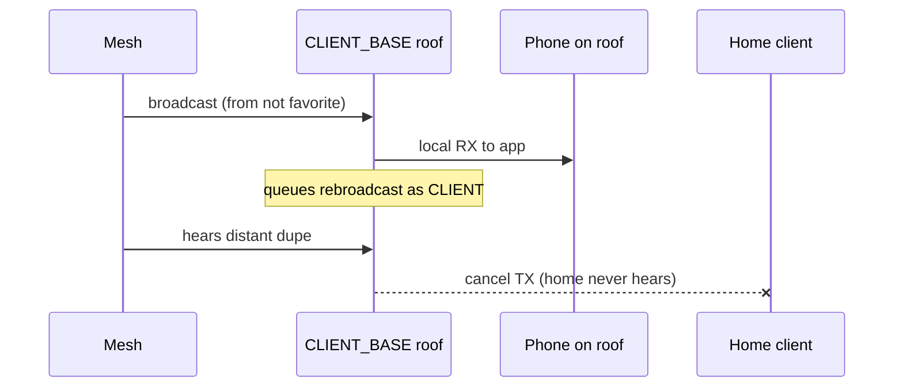
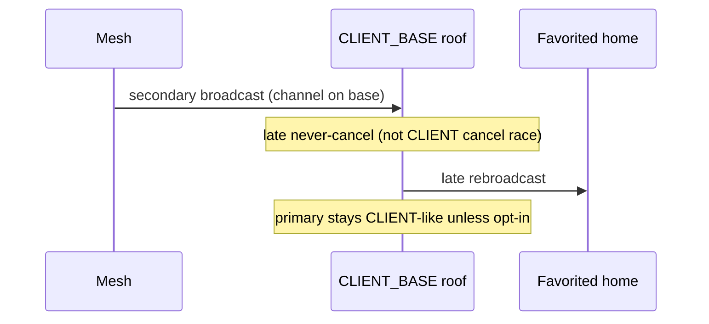
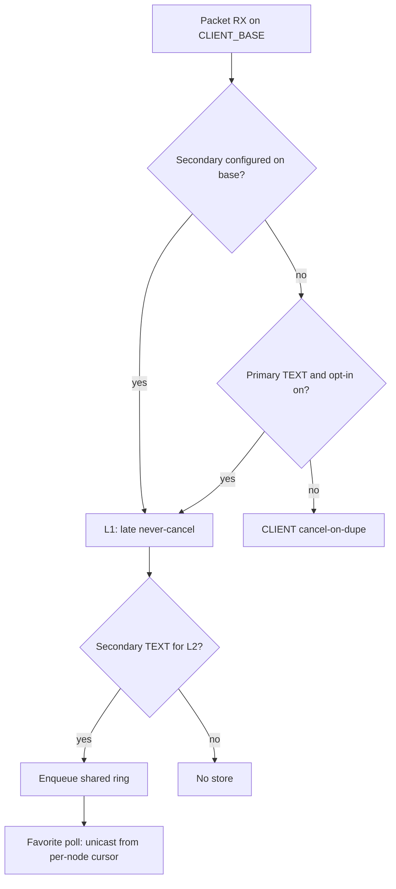

# Schemas — CLIENT_BASE

Aligned with locked policy (`ANALYSIS_AND_SIMULATION.md`).

## Today (broken expectation)



## Target L1 default (secondary only)



## Policy decision (sim-backed)



## Target L2 (secretary, multi-reader)

```mermaid
sequenceDiagram
  participant Mesh
  participant Roof as Base buffer
  participant A as Favorite A
  participant B as Favorite B
  Mesh->>Roof: secondary TEXT
  Roof->>Roof: enqueue shared ring
  A->>Roof: poll
  Roof->>A: unicast; advance cursor_A
  Note over Roof: payload remains
  B->>Roof: poll later
  Roof->>B: unicast from cursor_B
```

## Multi-reader cursors

```
ring: [m0 m1 m2 m3 m4 ...]  (TTL / capacity drops oldest)
cursor[Anna] = 2
cursor[Bart] = 0
```

## Airtime intuition (from sim)

```
today .............. ~54 TX / 100 heard
L1 secondary-only .. ~60 TX / 100 heard   ← default target
L1-all / ROUTER* ... ~92 TX / 100 heard   ← avoid as default
```
